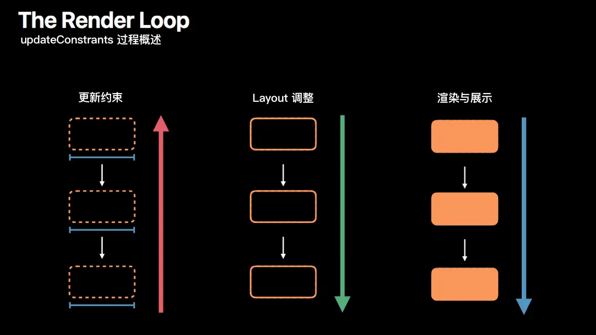

# iOS 布局系统：布局原理

在 iOS 中，系统并不会在你修改每个视图属性时立即重新计算布局。布局计算是**有代价的**，如果每次改一个 frame、修改约束就立刻布局，性能会大幅下降。为了平衡性能和响应速度，UIKit 采用了**延迟布局**机制：视图的布局通常在 **下一次 RunLoop 空闲时统一处理**。

从开发者的角度来看，我们通常通过 Frame、Auto Layout 或 SwiftUI 来**描述布局**。不管你用哪种方式，最终系统都需要做三件事情：

1. **测量尺寸**：计算每个视图的理想大小（intrinsicContentSize 或约束解算）
2. **确定位置**：根据父视图和约束规则，计算每个子视图的 frame
3. **应用布局**：把计算出的 frame 写入 UIView 和对应的 CALayer，由 GPU 渲染到屏幕

换句话说，布局本质上是一个 **“从规则到最终 frame 的计算过程”**，而这些计算的触发时机和方式直接影响性能和体验。理解了这个原理后，我们就可以进一步讨论布局的生命周期、触发和执行机制。


## 一、布局生命周期（Render Loop）

布局不仅仅是计算 frame，更是一个 **多阶段的循环流程**，在 iOS 中被称为 **Render Loop**。系统通过 Render Loop 确保每一帧都能高效、正确地渲染界面。

其核心分为三个阶段：



| 阶段                              | 方向     | 主要方法                                                     | 描述                                                |
| --------------------------------- | -------- | ------------------------------------------------------------ | --------------------------------------------------- |
| **更新约束（Constraint Update）** | 自底向上 | `updateConstraints()`, `setNeedsUpdateConstraints()`, `updateConstraintsIfNeeded()` | 检查子视图约束是否“dirty”，向父视图汇报，形成约束树 |
| **布局调整（Layout）**            | 自顶向下 | `layoutSubviews()`, `setNeedsLayout()`, `layoutIfNeeded()`   | 父视图先布局自己，再对子视图布局，计算最终 frame    |
| **渲染与展示（Rendering）**       | 自顶向下 | `draw(_:)`, `setNeedsDisplay()`                              | 布局完成后提交到 CALayer，由 GPU 渲染到屏幕         |

**关键点**：

1. 约束更新是 **子视图向父视图汇报**（自底向上）
2. 布局计算和渲染是 **父视图先处理，再对子视图处理**（自顶向下）
3. 每次修改约束或布局属性，不会立即计算，而是通过 **Render Loop 批量处理**
4. 避免频繁改变约束/布局属性，否则可能导致性能开销


## 二、布局触发

在 iOS 中，布局计算是**有代价的**。为了平衡性能和响应速度，UIKit 采用了 **延迟布局机制**：大部分布局更新都会**在下一次 RunLoop 空闲时统一处理**。

从开发者的角度来看，布局触发可以分为两大类：

### 1. 延迟布局

延迟布局是指 **视图被标记为需要布局，但实际计算会延迟到 RunLoop 空闲时统一处理**。

其特点为：

- 异步执行，不阻塞当前线程
- 同一视图多次调用会自动合并，避免重复计算
- 不会立即触发 `layoutSubviews()`

#### 1.1 系统自动触发

某些事件会自动标记视图需要布局，相当于系统帮你内部调用了 `setNeedsLayout()`：

- **外部环境变化**：屏幕旋转、尺寸类变化、系统字体大小改变
- **视图树结构变化**：添加/移除子视图、调整子视图层级
- **视图尺寸变化**：修改 frame 或 bounds 时，父视图会感知并标记自己需要布局

```
// 系统自动触发示例
parentView.addSubview(childView)   // 自动标记父视图需要布局
childView.removeFromSuperview()    // 同样触发布局
view.frame = CGRect(x:0, y:0, width:100, height:50) // 父视图感知 frame 改变
```

这些情况下，你无需手动调用 `setNeedsLayout()`。

#### 1.2 手动触发

如果修改的属性系统无法自动感知，就需要手动调用：

```swift
// 标记视图需要重新布局
view.setNeedsLayout()

// 发生了什么？
// 1. 在视图上打个标记："我需要重新布局"
// 2. 立即返回，不立即计算
// 3. 等到当前RunLoop周期结束时统一处理
```

例如：

- 修改约束 constant 或激活/失活约束
- 改变 `intrinsicContentSize`
- 自定义属性影响子视图布局


### 2. 立刻布局

立即布局是指 **如果视图被标记为需要布局，立刻同步计算**。

```swift
// 如果标记了需要布局，立即执行
view.layoutIfNeeded()

// 发生了什么？
// 1. 检查这个视图是否被标记为需要重新布局
// 2. 如果是，立即触发布局计算
// 3. 布局是同步执行的，会阻塞当前线程直到完成
```

**特点：**

- 同步执行，立即计算布局
- 会触发 `layoutSubviews()` 调用
- 如果视图没有被标记，什么都不做

**适合场景：**

- 动画中需要立即更新布局时
- 需要立即获取最新frame时
- 在尺寸变化后需要立即调整子视图时

```swift
func calculatePosition() {
    // 先更新约束
    widthConstraint.constant = 100
    
    // 立即计算布局
    view.layoutIfNeeded()
    
    // 现在可以获取到正确的frame
    let frame = view.frame
}
```

### 3. 对比

| 方法               | 执行时机              | 是否立即布局 | 性能影响           | 使用场景                 |
| :----------------- | :-------------------- | :----------- | :----------------- | :----------------------- |
| `setNeedsLayout()` | 当前RunLoop周期结束时 | 否（异步）   | 低（批量处理）     | 常规布局更新             |
| `layoutIfNeeded()` | 立即执行              | 是（同步）   | 高（可能重复计算） | 动画、需要立即结果的场景 |


## 三、布局执行

当系统决定要重新布局时，最终都会调用 `layoutSubviews()` 方法，这是 UIView 布局的核心环节。

### 系统在 `layoutSubviews()` 做了什么？

```swift
class CustomView: UIView {
    override func layoutSubviews() {
        super.layoutSubviews()  // ✅ 必须调用父类
        
        // 使用 bounds 布局子视图
        let width = bounds.width
        let height = bounds.height
        
        subview1.frame = CGRect(x: 10, y: 10,
                               width: width - 20,
                               height: height / 2)
        
        subview2.frame = CGRect(x: 10, y: height / 2 + 10,
                               width: width - 20,
                               height: height / 2 - 10)
    }
}
```

**关键点：**

* 父视图先布局自己，再对子视图布局（自顶向下传递）
* 不要在这里调用 `setNeedsLayout()`，否则会导致死循环
* 保持高性能：避免复杂计算、重复创建对象
* 只布局直接子视图，系统会递归处理子视图


## 四. 布局传递

布局不是一次性完成的，而是一个 **自顶向下、递归传递** 的过程。父视图先布局自己，再对子视图布局，子视图的变化可能反过来影响父视图或兄弟视图（尤其在 Auto Layout 场景中，虽然这里不深入约束细节，但原理类似）。

### 1. 布局传递流程

```tex
触发布局（如屏幕旋转）
      ↓
[根视图 setNeedsLayout]
      ↓
RunLoop空闲，系统调用根视图 layoutSubviews()
      ↓
根视图布局直接子视图
      ↓
子视图 frame 或 bounds 改变
      ↓
如果子视图自身布局依赖父视图或兄弟视图 → 子视图 setNeedsLayout
      ↓
子视图 layoutSubviews() 被调用
      ↓
递归传递到叶子节点
```

示例

```swift
// 视图树
// - RootView
//   - ContainerView
//     - Label
//     - Button

// 当设备旋转：
RootView.setNeedsLayout()          // 标记需要布局
// RunLoop 空闲
RootView.layoutSubviews()          // 布局 ContainerView
ContainerView.bounds 改变 → setNeedsLayout
ContainerView.layoutSubviews()     // 布局 Label 和 Button
```

**注意**：

- 父视图布局完成后，才会触发子视图布局
- 子视图布局完成后，如果影响父视图或兄弟视图，再次触发布局可能会产生链式更新

### 2. 父子视图布局互相影响

1. **父视图影响子视图**
   - 父视图的 frame / bounds 改变，会影响子视图的位置和大小
   - 如果子视图依赖父视图尺寸（例如 `frame = bounds.insetBy(...)`），必须重新布局
2. **子视图影响父视图**
   - 子视图的 `intrinsicContentSize` 或自定义尺寸可能触发父视图重新计算（尤其在自适应容器中）
   - 父视图可能需要调整其他子视图，形成链式布局
3. **兄弟视图影响**
   - 子视图之间有依赖关系时（例如水平堆叠，左边子视图宽度变化影响右边子视图位置），布局变化会递归传递


### 3. 性能影响

布局传递虽然灵活，但代价很高：

- **一个视图的布局变化可能引发连锁反应**
- **深层嵌套的视图树布局代价更高**
- **不必要的布局传递会降低性能**

#### 优化建议

1. **减少不必要的 setNeedsLayout()**

   如果只是改变颜色、alpha、隐藏状态等，不需要布局传递

2. **批量更新布局**

   修改多个属性后，再统一调用 `setNeedsLayout()`，避免多次递归布局

   ```
   UIView.performWithoutAnimation {
       view1.frame = ...
       view2.frame = ...
       containerView.setNeedsLayout()
   }
   ```

3. **避免在 layoutSubviews 中触发 setNeedsLayout**

​        会导致布局循环，甚至死循环

4. **尽量减少层级深度**

​       深层嵌套视图树增加布局传递次数，对于性能敏感界面，可考虑扁平化视图结构。

5. **只布局必要的子视图**

   layoutSubviews 中只更新直接子视图，系统会递归处理子视图，无需手动触发。


## 五、最佳实践

### 1. 布局触发的时机与代价

在 UIKit 中，**真正昂贵的不是“修改属性”，而是“触发布局计算”**。

`setNeedsLayout()` 和 `layoutIfNeeded()` 并不是功能重叠的 API，而是分别代表了两种**完全不同的布局策略**：

- **延迟布局**：把计算交给系统，在下一个 Render Loop 统一完成
- **同步布局**：立即执行布局计算，并递归影响子视图

在不需要立即使用布局结果的情况下，**延迟布局几乎永远是更优选择**。

```
// ✅ 推荐：批量修改 + 延迟布局
func updateLayout() {
    updateView1()
    updateView2()
    updateView3()
    
    view.setNeedsLayout()
}
```

这种写法可以让系统：

- 合并多次状态变化
- 减少重复的父子视图布局传递
- 把一次布局的代价，控制在最低

相反，如果在每一次状态修改后都强制同步布局：

```swift
// ❌ 常见但代价高昂
func updateLayoutBad() {
    updateView1()
    view.layoutIfNeeded()
    
    updateView2()
    view.layoutIfNeeded()
    
    updateView3()
    view.layoutIfNeeded()
}
```

那么你付出的代价是：

- 多次完整布局计算
- 多次自顶向下的视图树遍历
- 在复杂界面中，极易成为性能瓶颈


### 2. 避免布局循环

在 UIKit 中，布局是一个**由系统调度的闭环过程**。一旦这个闭环被人为破坏，就会出现最危险的一类问题：**布局循环（Layout Feedback Loop）**。

布局循环指的是：

> **在布局计算过程中，再次触发新的布局请求，从而导致布局无法稳定收敛。**

最典型、也最隐蔽的错误，就是在 `layoutSubviews()` 中触发布局更新。

```swift
class ProblematicView: UIView {
    override func layoutSubviews() {
        super.layoutSubviews()
        
        // ❌ 危险：在布局阶段再次请求布局
        self.setNeedsLayout()
    }
}
```

这段代码的问题不在于“会不会立刻死循环”，而在于：

- `layoutSubviews()` **本身就是布局执行阶段**

- 再次调用 `setNeedsLayout()`，等价于告诉系统：

  > “我刚算完，但结果不可信，下次再算一次”

最终表现可能是：

- 布局频繁执行，CPU 飙高
- 界面卡顿，但无明显崩溃
- Instruments 中看到大量 `layoutSubviews` 调用

`layoutSubviews()` 的**唯一职责**是：**在已确定的规则和父视图 bounds 下，计算并设置子视图的 frame**

```swift
class SafeView: UIView {
    override func layoutSubviews() {
        super.layoutSubviews()
        
        // ✅ 只做一件事：基于当前 bounds 布局子视图
        subview.frame = bounds.insetBy(dx: 10, dy: 10)
    }
}
```

#### 那么，当布局规则本身需要变化时，正确的处理方式是什么？

如果某个状态变化**会影响布局规则本身**，正确的做法是：

- 在 **setter / 状态变更点** 修改
- 然后调用 `setNeedsLayout()`
- 让系统在下一个布局周期统一处理

```swift
var isCompact: Bool = false {
    didSet {
        // 状态变化点
        setNeedsLayout()
    }
}
```

这样可以保证：

- 布局逻辑只在布局阶段执行
- 布局触发只发生在“规则变化时”
- Render Loop 能正常收敛


### 3. 减少无意义的布局传递

**为什么有些页面一改一个小状态，却触发了大量视图的 `layoutSubviews()`？**

答案在于：**布局是会传递的，而且代价是放大的。**

一次布局计算，通常意味着：

1. 父视图开始布局
2. 计算并设置子视图 frame
3. 子视图 bounds 改变
4. 子视图标记自己需要布局
5. 递归向下传递

这意味着：

> **一个看似局部的变化，可能触发整棵子树的布局。**

#### 常见的“无意义布局触发”

##### 与布局无关的属性，却触发布局

```swift
// ❌ 没必要
view.backgroundColor = .red
view.setNeedsLayout()
```

颜色、透明度、transform（不影响 bounds）等属性：

- 不参与布局计算
- 不应该触发布局请求

##### 高频状态变化中强制同步布局

```swift
// ❌ 在滚动 / 手势中频繁同步布局
func onScroll() {
    view.setNeedsLayout()
    view.layoutIfNeeded()
}
```

这会导致：

- 每一次事件都触发完整布局
- 布局无法被 RunLoop 合并
- 帧率显著下降

#### 推荐的性能友好写法

##### 技巧一：批量修改 + 一次布局请求

```swift
func updateAllViews() {
    UIView.performWithoutAnimation {
        updateFrame1()
        updateFrame2()
        updateConstraint1()
        updateConstraint2()
    }
    view.setNeedsLayout()
}
```

- 多次状态变化 → 一次布局
- 避免中间态被布局系统捕捉
- Render Loop 能自然合并请求

##### 技巧二：明确“是否需要立即结果”

```
func prepareForAnimation() {
    // 只修改状态
    targetView.alpha = 0
    
    // 这里需要立刻知道 frame，用于动画起点
    view.layoutIfNeeded()
    
    UIView.animate(withDuration: 0.3) {
        self.targetView.alpha = 1
        self.view.layoutIfNeeded()
    }
}
```

原则不是“少用 layoutIfNeeded”，而是：只在“代码依赖布局结果”时使用它。