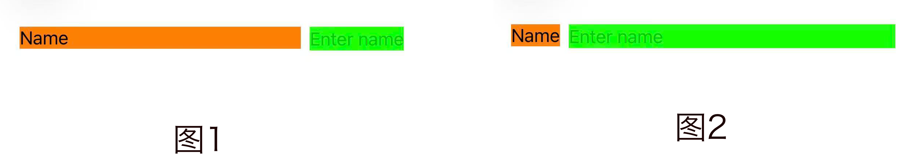

# iOS 布局系统：AutoLayout

在前两篇文章中，我们了解了 iOS 布局系统的基础概念和布局执行机制：

- 每个视图最终都会被计算成一个 `frame`
- 布局是一个沿视图树自低向上的动态传递过程
- UIKit 提供了 `layoutSubviews()`、`setNeedsLayout()`、`layoutIfNeeded()` 等 API 来管理布局生命周期

但是，当界面复杂起来，仅靠手动计算 frame 很容易出错，代码也变得难以维护。

Auto Layout 通过 **约束（NSLayoutConstraint）** 来描述视图之间的关系，而不是直接指定坐标。

从系统视角看，Auto Layout 的完整执行流程可以被高度抽象为四个阶段：

```
约束创建 → 激活约束 → 系统求解 → 计算 frame
```

它的核心思想是：

- **关系（Relation）**：等于、≥、≤
- **属性（Attribute）**：宽度、高度、中心点、边距等
- **优先级（Priority）**：权重，影响系统如何在冲突约束中做选择
- **乘数与常量（Multiplier & Constant）**：用于比例布局或偏移

例如，想让一个按钮永远在父视图中心：

```swift
button.translatesAutoresizingMaskIntoConstraints = false
NSLayoutConstraint.activate([
    button.centerXAnchor.constraint(equalTo: view.centerXAnchor),
    button.centerYAnchor.constraint(equalTo: view.centerYAnchor),
    button.widthAnchor.constraint(equalToConstant: 100),
    button.heightAnchor.constraint(equalToConstant: 50)
])
```

可以看到，Auto Layout 的**优点**是：

- 自动适应屏幕旋转或父视图大小变化
- 支持复杂的多视图关系
- 有优先级可以解决冲突

但是原生 Auto Layout 的**缺点**也很明显：

- 代码冗长，尤其是多视图布局
- 可读性不高，维护成本高
- 需要手动处理 `translatesAutoresizingMaskIntoConstraints`


为了让 Auto Layout 更**简洁、可读、易维护**，社区提供了 **SnapKit**。它是一个基于 Swift 的 DSL（领域专用语言）库，让你用链式语法快速定义约束：

```swift
button.snp.makeConstraints { make in
    make.center.equalToSuperview()      // 中心对齐
    make.width.height.equalTo(100)      // 固定宽高
}
```

SnapKit 的出现，极大降低了 Auto Layout 的使用成本，但它并没有改变 Auto Layout 的工作机制。

无论使用原生 API 还是 SnapKit，系统最终接收到的，仍然是一组 **NSLayoutConstraint**。

换句话说：**SnapKit 解决的是“怎么写约束更舒服”，而不是“约束是怎么被系统理解的”。**


那么问题来了：

- 一条约束，在系统层面是如何被“描述”的？
- Auto Layout 是如何保证约束的类型安全？
- 为什么 width 不能和 centerX 建立约束？

Apple 给出了答案 —— **NSLayoutAnchor**。


## 一、NSLayoutAnchor 约束描述

在 iOS 9.0 之后，Apple 提供了 **NSLayoutAnchor** API，使得 **Auto Layout** 约束的创建更加简洁和类型安全。它通过 **锚点（Anchor）** 的方式，让开发者无需手写繁琐的 `NSLayoutConstraint(item:attribute:...)`。

创建约束，有三层要素：

1. **Anchor（锚点）** ： 谁和谁建立约束
2. **Relation（关系）**： `=` / `≥` / `≤`
3. **Parameters（条件）**：constant、multiplier、priority

可以类比公式：

```
constraint = Anchor + Relation + Parameters
```


### 1. 约束锚点 

Anchor 是 **布局参考点**，不参与计算，只描述约束关系。每个 `UIView` 都提供了一组与自身位置和尺寸相关的 **锚点属性**：

```swift
extension UIView {
    open var leadingAnchor: NSLayoutXAxisAnchor { get }
    open var trailingAnchor: NSLayoutXAxisAnchor { get }
    open var leftAnchor: NSLayoutXAxisAnchor { get }
    open var rightAnchor: NSLayoutXAxisAnchor { get }
    open var topAnchor: NSLayoutYAxisAnchor { get }
    open var bottomAnchor: NSLayoutYAxisAnchor { get }
    open var widthAnchor: NSLayoutDimension { get }
    open var heightAnchor: NSLayoutDimension { get }
    open var centerXAnchor: NSLayoutXAxisAnchor { get }
    open var centerYAnchor: NSLayoutYAxisAnchor { get }
    open var firstBaselineAnchor: NSLayoutYAxisAnchor { get }
    open var lastBaselineAnchor: NSLayoutYAxisAnchor { get }
}
```

这些 Anchor 可以按方向和用途分为几类：

```css
UIView
├─ X 轴锚点 (NSLayoutXAxisAnchor)
│  ├─ leadingAnchor
│  ├─ trailingAnchor
│  ├─ leftAnchor
│  ├─ rightAnchor
│  └─ centerXAnchor
├─ Y 轴锚点 (NSLayoutYAxisAnchor)
│  ├─ topAnchor
│  ├─ bottomAnchor
│  ├─ centerYAnchor
│  ├─ firstBaselineAnchor
│  └─ lastBaselineAnchor
└─ 尺寸锚点 (NSLayoutDimension)
   ├─ widthAnchor
   └─ heightAnchor
```

这些 Anchor 具有共同的父类：**NSLayoutAnchor**

```swift
open class NSLayoutXAxisAnchor : NSLayoutAnchor<NSLayoutXAxisAnchor> { }
open class NSLayoutYAxisAnchor : NSLayoutAnchor<NSLayoutYAxisAnchor> { }
open class NSLayoutDimension : NSLayoutAnchor<NSLayoutDimension> { }
```

#### 1.1 leading / trailing 与 left / right 的区别

在大多数布局场景中，我们通常用 `leadingAnchor` 和 `trailingAnchor` 来代替 `leftAnchor` 和 `rightAnchor`。

它们的区别在于：

- 在从右到左的语言环境（如阿拉伯语、希伯来语）中：
  - `leadingAnchor` 实际代表右边
  - `trailingAnchor` 实际代表左边
- 在从左到右的语言环境（如中文、英文）中：
  - `leading == left`
  - `trailing == right`

使用 `leading` 和 `trailing` 可以让布局自动适配不同语言环境，而不用额外处理左右边界。

#### 1.2 firstBaseline / lastBaseline

这两个 Anchor 比较特殊：

- `firstBaselineAnchor`：文本组件的 **第一行** 基线
- `lastBaselineAnchor`：文本组件的 **最后一行** 基线

它们主要用于多行文本或 label 的垂直对齐场景。如果对这两个概念不太熟悉，可以先忽略，常用的布局一般不会直接用到。


### 2. 约束关系

Anchor 之间可以建立三类数学关系：

| 方法                 | 描述     | 示例                                                         |
| -------------------- | -------- | ------------------------------------------------------------ |
| equalTo              | 相等     | `viewA.leadingAnchor.constraint(equalTo: viewB.leadingAnchor)` |
| greaterThanOrEqualTo | 大于等于 | `viewA.leadingAnchor.constraint(greaterThanOrEqualTo: viewB.trailingAnchor)` |
| lessThanOrEqualTo    | 小于等于 | `viewA.trailingAnchor.constraint(lessThanOrEqualTo: container.trailingAnchor)` |

```swift
open class NSLayoutAnchor<AnchorType> : NSObject, NSCopying, NSCoding where AnchorType : AnyObject {
    open func constraint(equalTo anchor: NSLayoutAnchor<AnchorType>) -> NSLayoutConstraint
    open func constraint(greaterThanOrEqualTo anchor: NSLayoutAnchor<AnchorType>) -> NSLayoutConstraint
    open func constraint(lessThanOrEqualTo anchor: NSLayoutAnchor<AnchorType>) -> NSLayoutConstraint
}
```

**Anchor 本身不参与布局**，生成的 `NSLayoutConstraint` 才真正参与计算。

为了统一使用接口，Apple 设计了三个主要子类：

```swift
open class NSLayoutXAxisAnchor : NSLayoutAnchor<NSLayoutXAxisAnchor> { }
open class NSLayoutYAxisAnchor : NSLayoutAnchor<NSLayoutYAxisAnchor> { }
open class NSLayoutDimension   : NSLayoutAnchor<NSLayoutDimension> { }
```

**X 轴、Y 轴、尺寸 Anchor** 都继承自 `NSLayoutAnchor`，因此都可以使用 `= / ≥ / ≤` 约束方法。


#### 2.1 系统间距约束

`NSLayoutXAxisAnchor` 和 `NSLayoutYAxisAnchor` 的 **系统间距约束方法**，用于让视图之间保持 **符合系统推荐的标准间距**。

使用它可以保证布局符合 Human Interface Guidelines，无需自己计算常量，减少出错概率，尤其适合快速构建标准化 UI。

> **注意**：系统间距约束使用的是 **系统推荐的标准值**，开发者无需自己计算。

##### X 轴系统间距

```swift
extension NSLayoutXAxisAnchor {
    open func constraint(equalToSystemSpacingAfter anchor: NSLayoutXAxisAnchor, multiplier: CGFloat) -> NSLayoutConstraint
    open func constraint(greaterThanOrEqualToSystemSpacingAfter anchor: NSLayoutXAxisAnchor, multiplier: CGFloat) -> NSLayoutConstraint
    open func constraint(lessThanOrEqualToSystemSpacingAfter anchor: NSLayoutXAxisAnchor, multiplier: CGFloat) -> NSLayoutConstraint
}
```

- `equalToSystemSpacingAfter`：视图在目标视图 **右侧**，间距 = 系统推荐间距 × multiplier
- `greaterThanOrEqualToSystemSpacingAfter`：视图 **至少保持** 系统推荐间距 × multiplier
- `lessThanOrEqualToSystemSpacingAfter`：视图 **最多保持** 系统推荐间距 × multiplier


##### Y 轴系统间距

```swift
extension NSLayoutYAxisAnchor {
    open func constraint(equalToSystemSpacingBelow anchor: NSLayoutYAxisAnchor, multiplier: CGFloat) -> NSLayoutConstraint
    open func constraint(greaterThanOrEqualToSystemSpacingBelow anchor: NSLayoutYAxisAnchor, multiplier: CGFloat) -> NSLayoutConstraint
    open func constraint(lessThanOrEqualToSystemSpacingBelow anchor: NSLayoutYAxisAnchor, multiplier: CGFloat) -> NSLayoutConstraint
}
```

- `equalToSystemSpacingBelow`：视图在目标视图 **下方**，间距 = 系统推荐间距 × multiplier
- `greaterThanOrEqualToSystemSpacingBelow`：间距至少为系统推荐间距 × multiplier
- `lessThanOrEqualToSystemSpacingBelow`：间距最多为系统推荐间距 × multiplier


#### 2.2 尺寸间距约束

`NSLayoutDimension` 专门用于控制 **宽度和高度**，提供了三类约束：

```swift
open class NSLayoutDimension : NSLayoutAnchor<NSLayoutDimension> {

    // 固定尺寸
    open func constraint(equalToConstant c: CGFloat) -> NSLayoutConstraint
    open func constraint(greaterThanOrEqualToConstant c: CGFloat) -> NSLayoutConstraint
    open func constraint(lessThanOrEqualToConstant c: CGFloat) -> NSLayoutConstraint

    // 与另一维度按比例约束
    open func constraint(equalTo anchor: NSLayoutDimension, multiplier m: CGFloat) -> NSLayoutConstraint
    open func constraint(greaterThanOrEqualTo anchor: NSLayoutDimension, multiplier m: CGFloat) -> NSLayoutConstraint
    open func constraint(lessThanOrEqualTo anchor: NSLayoutDimension, multiplier m: CGFloat) -> NSLayoutConstraint

    // 与另一维度按比例 + 偏移量约束
    open func constraint(equalTo anchor: NSLayoutDimension, multiplier m: CGFloat, constant c: CGFloat) -> NSLayoutConstraint
    open func constraint(greaterThanOrEqualTo anchor: NSLayoutDimension, multiplier m: CGFloat, constant c: CGFloat) -> NSLayoutConstraint
    open func constraint(lessThanOrEqualTo anchor: NSLayoutDimension, multiplier m: CGFloat, constant c: CGFloat) -> NSLayoutConstraint
}
```

* **固定尺寸**

```swift
view.widthAnchor.constraint(equalToConstant: 100)
view.heightAnchor.constraint(greaterThanOrEqualToConstant: 50)
```

* **与另一维度按比例约束**

```swif swift t
viewA.widthAnchor.constraint(equalTo: viewB.widthAnchor, multiplier: 0.5)
viewA.heightAnchor.constraint(lessThanOrEqualTo: viewB.heightAnchor, multiplier: 1.2)
```

* **与另一维度按比例 + 偏移量约束**

```swift
viewA.widthAnchor.constraint(equalTo: viewB.widthAnchor, multiplier: 0.5, constant: 20)
viewA.heightAnchor.constraint(greaterThanOrEqualTo: viewB.heightAnchor, multiplier: 1.0, constant: -10)
```


#### 2.3 两点间距约束

从 **iOS 10** 开始，`NSLayoutXAxisAnchor` 和 `NSLayoutYAxisAnchor` 提供了：

```swift
open class NSLayoutXAxisAnchor : NSLayoutAnchor<NSLayoutXAxisAnchor> {
    open func anchorWithOffset(to otherAnchor: NSLayoutXAxisAnchor) -> NSLayoutDimension
}
```

```swift
open class NSLayoutYAxisAnchor : NSLayoutAnchor<NSLayoutYAxisAnchor> {
    open func anchorWithOffset(to otherAnchor: NSLayoutYAxisAnchor) -> NSLayoutDimension
}
```

它的核心作用是：**把两个位置 Anchor 之间的距离，转换成一个可被约束的 NSLayoutDimension**。

```swift
// 1.常规写法
viewA.leadingAnchor.constraint(equalTo: viewB.trailingAnchor, constant: 20)

// 2.anchorWithOffset 写法（强调间距本身）
let spacing = viewA.trailingAnchor.anchorWithOffset(to: viewB.leadingAnchor)
spacing.constraint(equalToConstant: 20)
```

第一种写法：直接约束“位置 + 偏移量”

第二种写法：先抽象“两个 Anchor 的距离”，再对距离设置约束

本质功能一样，只是 **语义不同**，anchorWithOffset，使用场景较少，更适合 **动画、动态间距或复杂布局计算**。


### 3. 约束条件

约束条件决定了 **Anchor 约束的具体量化方式**，主要包括 **constant、multiplier、priority** 三个参数。它们可以单独使用，也可以组合使用。

| 参数       | 说明              | 示例                                                | 类比 SnapKit        |
| ---------- | ----------------- | --------------------------------------------------- | ------------------- |
| constant   | 偏移量 / 固定间距 | `constraint(equalTo: anchor, constant: 20)`         | `offset(20)`        |
| multiplier | 比例 / 倍数       | `constraint(equalTo: widthAnchor, multiplier: 0.5)` | `multipliedBy(0.5)` |
| priority   | 优先级            | `constraint.priority = .defaultHigh`                | `priority(.high)`   |


#### 3.1 constant：位置与尺寸的“绝对偏移量”

`constant` 用于描述 **在既定关系上的偏移或固定值**，默认值为 `0`。

**位置偏移**

```swift
// viewA 在 viewB 右侧，间距 20
viewA.leadingAnchor
    .constraint(equalTo: viewB.trailingAnchor, constant: 20)

// viewA 在 viewB 下方，上移 10（产生重叠）
viewA.topAnchor
    .constraint(equalTo: viewB.bottomAnchor, constant: -10)
```

这里需要注意：**constant 的正负，永远以 Anchor 的“正方向”为基准，而不是屏幕方向。**

**固定尺寸**

设置宽度或高度为`constant` 尺寸值。

```swift
viewA.widthAnchor.constraint(equalToConstant: 100)
viewA.heightAnchor.constraint(equalToConstant: 50)
```


#### 3.2 multiplier：比例关系

`multiplier` 只用于 **NSLayoutDimension（宽、高）**，用于描述两个尺寸之间的比例关系，默认值为 `1.0`。

```swift
// viewA 宽度 = viewB 宽度的 0.5 倍
viewA.widthAnchor
    .constraint(equalTo: viewB.widthAnchor, multiplier: 0.5)

// viewA 高度 = viewB 高度的 1.2 倍
viewA.heightAnchor
    .constraint(equalTo: viewB.heightAnchor, multiplier: 1.2)
```

**一旦创建，无法修改**：multiplier 直接参与线性方程构建，一旦修改，就意味着重建约束图。

因此，如果你需要“动态比例变化”，正确的做法是：

- 停用旧约束
- 创建并激活一条新的约束

在SnapKit中，同样如此。一旦创建比例关系，就需要先移除，再创建。 

```swift
button.snp.makeConstraints { make in
    make.width.equalTo(superview).multipliedBy(0.8)
}
```


### 4. Intrinsic Content Size

在使用 Auto Layout 时，经常会遇到这样一种情况：

> 明明没有给视图设置宽高，它却依然能正常显示，并且大小刚刚好。

这背后的核心机制，就是 **Intrinsic Content Size**。

在 Auto Layout 中，视图的尺寸通常来源于三种方式：

1. 显式约束（width / height）
2. 与其他视图的相对约束
3. **Intrinsic Content Size**

当一个视图**可以根据自身内容计算合理尺寸**时，系统就不再强制要求你为它设置宽高约束。

#### 4.1 什么是 Intrinsic Content Size？

**Intrinsic Content Size** 可以理解为：

> **视图根据自身内容，向 Auto Layout 提供的“理想尺寸”。**

它是视图**主动提供**的尺寸信息，用于参与布局计算，而不是布局计算后的最终结果。

换句话说：

- Intrinsic Content Size：**我“希望”自己多大**
- Auto Layout：**我“最终”会多大**


#### 4.2 哪些控件拥有 Intrinsic Content Size？

| 控件                    | 是否拥有 Intrinsic Content Size | 计算依据 / 说明                                              |
| ----------------------- | ------------------------------- | ------------------------------------------------------------ |
| UILabel                 | 有 ✔️                            | 根据 text / font / numberOfLines 计算                        |
| UIButton                | 有 ✔️                            | 根据 titleLabel、imageView、contentEdgeInsets、titleEdgeInsets / imageEdgeInsets 组合计算 |
| UIImageView             | 有 ✔️                            | 根据 image.size，image 为 nil 时为 (0,0)                     |
| UISwitch                | 有 ✔️                            | 系统固定尺寸                                                 |
| UIActivityIndicatorView | 有 ✔️                            | 系统 style 决定大小                                          |
| UIView                  | 没有                            | 默认不提供 intrinsicContentSize，必须通过约束或 frame 指定大小 |

所有视图最终都会有 size，但不是所有视图都会提供 intrinsicContentSize。

##### UILabel 的特殊行为

UILabel 的 **多行文本**在宽度受约束时，高度会自动计算，而 intrinsicContentSize.width 不再起作用。


##### 为自定义 View 提供 Intrinsic Content Size

**UIView 本身不关心内容**，它只是一个容器：不知道里面放了什么，也不假设自己“应该多大”。

UIView 默认没有 intrinsicContentSize，但可以通过重写提供：

```
class MyView: UIView {
    override var intrinsicContentSize: CGSize {
        return CGSize(width: 80, height: 32)
    }
}
```

当内部内容变化时，需要主动通知系统，否则：Auto Layout 不会重新计算布局，视图尺寸不会更新。

```
myView.invalidateIntrinsicContentSize()
```


### 5. 约束优先级

在使用 Auto Layout 时，我们经常会遇到这样的问题：

- 为什么有的视图被压缩了，而另一个却完整显示？
- 明明两个视图都有 Intrinsic Content Size，系统凭什么选其中一个“让步”？

这些问题的答案，都指向同一个核心概念：**UILayoutPriority**。

#### 5.1 UILayoutPriority 是什么？

UILayoutPriority 本质上是：**当多个布局约束无法同时满足时，系统用来决定“谁更重要”的权重。**

在 Auto Layout 中：**每一条约束，都是对布局的一种“描述”**，当这些描述发生冲突时，系统并不会报错，而是：

- **优先满足优先级更高的约束**
- 放弃或弱化优先级更低的约束
- `.required` 冲突 会在控制台警告

#### 5.2 UILayoutPriority 的取值

在 iOS 中，每个约束都有一个 **priority（优先级）**，系统在布局冲突时会根据优先级决定“哪个约束可以让步”。
`UILayoutPriority` 本质上就是一个 **Float** 类型，范围 0 ~ 1000，数值越大，约束越“重要”。

定义如下：

```swift
public struct UILayoutPriority : Hashable, Equatable, RawRepresentable {
    public init(_ rawValue: Float)
    public init(rawValue: Float)
}

extension UILayoutPriority {
    public static let required         // 1000
    public static let defaultHigh      // 750
    public static let defaultLow       // 250
    public static let fittingSizeLevel // 50
}
```

默认值说明：

| 值                   | 数值 | 含义                                                         |
| -------------------- | ---- | ------------------------------------------------------------ |
| **required**         | 1000 | **必须满足，不能被打破**。Anchor API 默认约束就是 required。系统会尽力满足这些约束，即使要牺牲其他约束或压缩内容也要满足。 |
| **defaultHigh**      | 750  | **很重要，可在必要时让步**，表示约束“希望被满足”，但在 required 约束面前可以让步。常用在 CR（抗压缩）和 CH（抗拉伸）设置中。 |
| **defaultLow**       | 250  | **不重要，容易被打破**，表示约束可以被轻易让步，适合非核心布局调整。 |
| **fittingSizeLevel** | 50   | **用于系统计算合适尺寸**，不参与正常几何约束冲突决策。       |

##### 自定义优先级

开发者可以通过 `UILayoutPriority(Float)` 自定义约束优先级，例如：

```swift
// 自定义一个优先级为 600 的约束
someConstraint.priority = UILayoutPriority(600)
```


#### 5.3 Intrinsic Content Size 与布局优先级

**Intrinsic Content Size 是视图的“理想尺寸”，但在实际布局中可能被压缩或拉伸**。

##### CH / CR 概念

- **CH (Content Hugging)**：防止视图被拉大
- **CR (Content Compression Resistance)**：防止视图被压缩

IntrinsicContentSize 提供的宽高，其实相当于为 NSISEngine 添加了两个“带优先级的约束”：

| 属性                           | 含义     | 默认优先级 |
| ------------------------------ | -------- | ---------- |
| Content Hugging                | 最大尺寸 | 250 (低)   |
| Content Compression Resistance | 最小尺寸 | 750 (高)   |

原理：CH 越高 → 越不愿被拉伸；CR 越高 → 越不愿被压缩。


##### 实例： UILabel + UITextField

**需求**：一行中左边是 label，右边是 textField，希望 label **保持自身大小**，textField **拉伸填充剩余空间**。

```swift
let label = UILabel()
label.backgroundColor = UIColor.orange
label.text = "Name"
label.translatesAutoresizingMaskIntoConstraints = false

let textField = UITextField()
textField.backgroundColor = UIColor.green
textField.placeholder = "Enter name"
textField.translatesAutoresizingMaskIntoConstraints = false

view.addSubview(label)
view.addSubview(textField)

NSLayoutConstraint.activate([
    label.topAnchor.constraint(equalTo: view.safeAreaLayoutGuide.topAnchor, constant: 20),
    label.leftAnchor.constraint(equalTo: view.leftAnchor, constant: 20),
    label.rightAnchor.constraint(equalTo: textField.leftAnchor, constant: -8),
    
    textField.topAnchor.constraint(equalTo: label.topAnchor),
    textField.rightAnchor.constraint(equalTo: view.rightAnchor, constant: -20),
])
```

**现象**（如图1）：

- label 的 intrinsicContentSize 是 (50, 20)
- textField 没有 intrinsicContentSize（UITextField 会有最小内容，但一般很小）
- 系统默认 **同时满足约束 + 尝试填充父视图**
- 结果：UILabel 被拉伸，textField 却没有拉伸到剩余空间



如果我们希望label按照实际宽度展示，拉伸textFiled（如图2）：

```
// 让 label 更倾向保持自身大小
label.setContentHuggingPriority(UILayoutPriority(rawValue: 251), for: .horizontal)
// 让 textField 更倾向被拉伸
textField.setContentHuggingPriority(UILayoutPriority(rawValue: 249), for: .horizontal)
```

**可以想象成**：CH 越高 → “我不想变大”，所以 label 不被拉伸；textField CH 低 → “随便拉伸”，就占满剩余空间。


#### 5.4 示例：两个 UILabel 的布局博弈

下面这个例子，是理解 UILayoutPriority 的**经典场景**。

##### 情况1

**leftLabel** 和 **rightLabel** 的文本都很长，Intrinsic Content Size 超过了父视图宽度，所以必然有一个被压缩。

```swift
class LayoutPriorityViewController: UIViewController {
    
    // 左侧 Label
    let leftLabel: UILabel = {
        let lbl = UILabel()
        lbl.translatesAutoresizingMaskIntoConstraints = false
        lbl.text = "这是左侧很长的文本，这是左侧很长的文本，这是左侧很长的文本"
        lbl.backgroundColor = .orange
        return lbl
    }()
    
    // 右侧 Label
    let rightLabel: UILabel = {
        let lbl = UILabel()
        lbl.translatesAutoresizingMaskIntoConstraints = false
        lbl.text = "这是右侧很长的文本，这是右侧很长的文本，这是右侧很长的文本"
        lbl.backgroundColor = .green
        return lbl
    }()
    
    override func viewDidLoad() {
        super.viewDidLoad()

        view.addSubview(leftLabel)
        view.addSubview(rightLabel)
        
        NSLayoutConstraint.activate([
            // 设置顶部约束
            leftLabel.topAnchor.constraint(equalTo: view.safeAreaLayoutGuide.topAnchor, constant: 40),
            rightLabel.topAnchor.constraint(equalTo: leftLabel.topAnchor),
            
            // 设置左右约束
            leftLabel.leadingAnchor.constraint(equalTo: view.leadingAnchor, constant: 20),
            rightLabel.trailingAnchor.constraint(equalTo: view.trailingAnchor, constant: -20),
          
            // 设置两者的间距
            leftLabel.trailingAnchor.constraint(equalTo: rightLabel.leadingAnchor, constant: -8),
        ])
    }
    
    private func setupOtherConstraint() {
        // 等待设置其他约束
    }
}
```

**现象**

* 左侧 Label 占满横向剩余空间
* 右侧 Label 被压缩严重，文本没有任何空间显示

**理论**

- 所有约束都是 required

- 系统必须满足几何约束，但没有明确压缩优先级

- 压缩通常从右侧开始，因为左侧先满足自身 Intrinsic Content Size

  

##### 情况2

在 setupOtherConstraint 中新增：

```swift
NSLayoutConstraint.activate([
    rightLabel.widthAnchor.constraint(greaterThanOrEqualToConstant: 100),
])
```

**现象**

* 左侧 Label 被压缩严重，文本没有任何空间显示

* 右侧 Label 占满横向剩余空间

**理论**

* `rightLabel.width >= 100` 是 required 级别约束，系统必须保证右侧至少 100pt 宽度。
* 系统必须保证右侧至少 100pt 宽度

##### 情况3

在 setupOtherConstraint 中新增：

```swift
NSLayoutConstraint.activate([
    // 右侧最小宽度
    rightLabel.widthAnchor.constraint(greaterThanOrEqualToConstant: 100),
])
// 左侧：强烈希望显示完整内容
leftLabel.setContentCompressionResistancePriority(.required, for: .horizontal)
```

**现象**

* 右侧label被压缩，但保证了最小看度100
* 左侧label 占满了剩余空间

**理论**

* Required 级别几何约束先满足（右侧最小宽度）
* 左侧 CR = required → 左侧不被压缩
* 右侧 CR 默认较低 → 右侧成为优先压缩对象


## 二、NSLayoutConstraint  约束生效

`NSLayoutAnchor` **只负责“描述关系”**，`NSLayoutConstraint` **才是让这条关系进入 Auto Layout 系统并参与求解的实体**。

只有当约束被**激活（isActive = true）**后，系统才会在 **Layout Pass** 中将其纳入约束方程，计算最终的 `frame`。

### 1. 激活与取消约束

#### 单个约束时

适用于需要**单独控制生命周期**的约束（如高度切换、动画等）。

```
// 创建约束（尚未生效）
let c = viewA.heightAnchor.constraint(equalToConstant: 100)

// 激活：加入 Auto Layout 求解系统
c.isActive = true

// 取消：从求解系统中移除
c.isActive = false
```

#### 多个约束时

当多个约束**同时决定一个布局结果**时，推荐批量激活 / 取消。

```
NSLayoutConstraint.activate([
    viewA.topAnchor.constraint(equalTo: viewB.bottomAnchor, constant: 10),
    viewA.leadingAnchor.constraint(equalTo: viewB.leadingAnchor)
])

NSLayoutConstraint.deactivate([
    viewA.topAnchor.constraint(equalTo: viewB.bottomAnchor),
    viewA.leadingAnchor.constraint(equalTo: viewB.leadingAnchor)
])
```

批量激活会**一次性**将所有约束加入 Auto Layout 系统：

* 避免中间状态

* 防止短暂的布局不完整或冲突

* 布局语义更完整

这些约束在逻辑上是**一个整体**。相比逐条 `isActive = true`，可以减少多次布局计算，系统只触发一次约束求解。

### 2. identifier

给**已生效的约束**起名字，**当约束冲突或调试布局时，便于快速识别具体是哪一条约束**。

#### 设置 identifier

只要你 **持有 NSLayoutConstraint 实例**，在约束被激活之前或之后都可以。

```
let c = viewA.topAnchor.constraint(equalTo: viewB.bottomAnchor, constant: 10)
c.identifier = "viewA.top = viewB.bottom + 10"
c.isActive = true
```

批量激活时，这种写法 **无法设置 identifier**（没有引用）

```
NSLayoutConstraint.activate([
    viewA.topAnchor.constraint(equalTo: viewB.bottomAnchor, constant: 10),
    viewA.leadingAnchor.constraint(equalTo: viewB.leadingAnchor)
])
```

 需要**先生成 → 标记 → 再激活**

```
let top = viewA.topAnchor.constraint(equalTo: viewB.bottomAnchor, constant: 10)
top.identifier = "viewA.top → viewB.bottom"

let leading = viewA.leadingAnchor.constraint(equalTo: viewB.leadingAnchor)
leading.identifier = "viewA.leading → viewB.leading"

NSLayoutConstraint.activate([top, leading])
```


## 三、Auto Layout 的系统求解与 Frame 计算

当约束被激活后，Auto Layout 会在 **Layout Pass** 中统一求解，将约束描述转化为每个视图的最终 `frame`。整个过程可以理解为 **四步链条**：

### 1. 收集约束

系统会扫描整个视图层级，将所有约束统一收集：

1. **显式约束**：开发者通过 `NSLayoutConstraint` 或 SnapKit 等 DSL 创建的约束
2. **隐式约束**：视图的 `intrinsicContentSize`、系统默认间距约束等

收集到的约束，会构成一个完整的约束集合，描述了每个视图在父视图中的位置、尺寸和相对关系。

### 2. 构建线性方程组

每条约束会被抽象成 **数学方程或不等式**：

```
viewA.width = viewB.width * multiplier + constant
viewA.leading = viewB.trailing + constant
viewA.height >= 44
```

- 宽度、高度是 **线性方程**
- 位置（x/y）通过父子关系和对齐约束形成线性不等式
- 优先级（priority）会被转化为 **约束的权重**，用于冲突折中

这些方程组合在一起，就形成了一个 **全局约束系统**，描述了整个界面的几何关系。


### 3. 求解线性系统

Auto Layout 使用 **带优先级的线性求解算法**（实现上源自 Cassowary 算法）来求解方程组：

- **Required 约束（priority = 1000）** 必须满足
- **可选约束（priority < 1000）** 尽量满足，若冲突可被折中
- 系统会在整体上找到一个最优解，使所有约束尽可能满足

> ⚠️ 求解是全局过程，不是逐条执行：系统会同时考虑每条约束的关系和优先级，保证最终布局最合理。


### 4. 写回 frame

求解完成后，每个视图的 **x/y/width/height** 被写回到对应的 `frame`：

- UIKit 会在 `layoutSubviews()` 中使用这些值
- frame 成为视图真正显示的尺寸和位置

因此，**frame 并不是约束直接设置的结果，而是 Auto Layout 求解后的产物**。

